# Anywhere Console pages

> **What a brand-new environment looks like.** Several pages are empty until time passes or a
> setting is turned on, and that is normal rather than broken:
> **Usage & Metering** reads all zeros (`Clusters tracked 0`, `Last metered at —`) because usage is
> sampled on an interval; the cluster **Overview** shows `—` for month-to-date CCU and "No data for
> this metric" for data volume, because that comparison needs a 24-hour baseline the cluster is
> too young to have; **Support** has no bundles until someone creates one; and **Query insights**
> is switched off by default — see Query insights on [Cluster Console pages](./cluster_console.md)
> for the two settings it needs.

## Sign in — `/login`

The **Platform administrator** tab of the shared sign-in page, which both consoles use. The path
decides which tab opens, so `/login` lands here and `/cluster-console/login` opens the Database user
tab; switching tabs is a click, not a navigation. Username and password go against the admin Secret.
A session-expiry notice appears here when an earlier session timed out, and sign-in returns you to
the page you were trying to reach (carried as `?redirect=`). A theme toggle sits in the top-right
corner, and the brand hero panel is shared by both tabs.

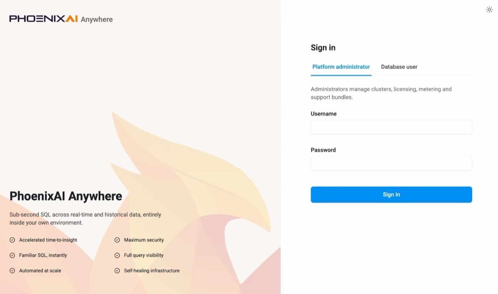

## Clusters — `/clusters`

The landing page: every cluster the installation can see, in **card view** or **table view**
(`?layout=table`). Both show name, status (Running / Creating / Stopped / Failed / Unknown), type,
version, coordinator address, warehouse count, namespace, creation time and license expiry — with
a near-expiry license highlighted. Selecting a cluster opens its detail page.

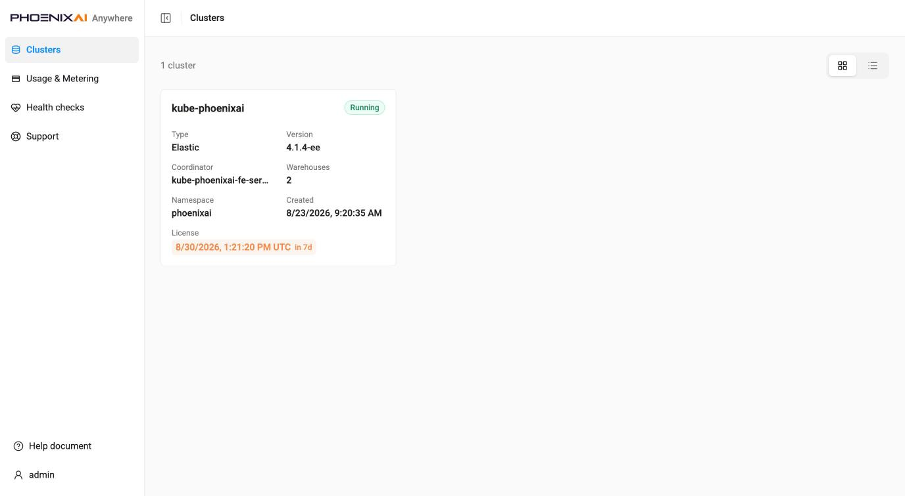

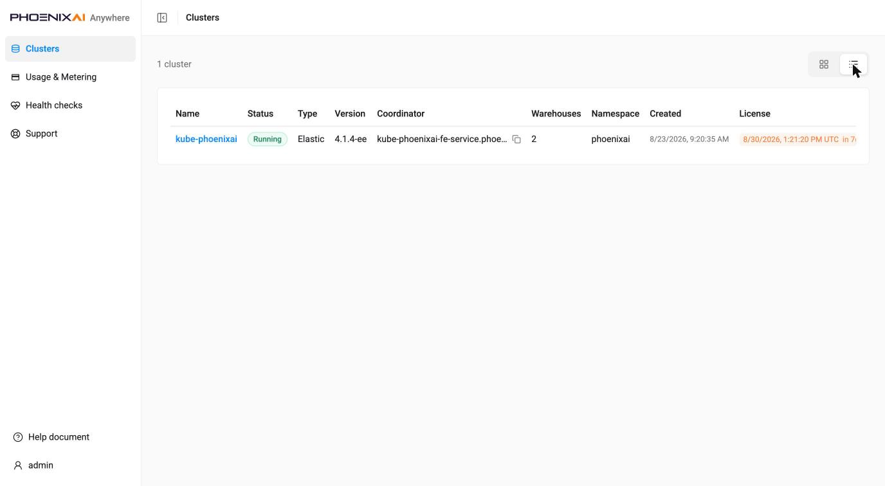

## Cluster detail — `/clusters/{ns}/{name}`

One cluster, as seven tabs addressed by `?tab=` so links stay shallow (`overview` is the default
and carries no parameter). **Open cluster** in the top-right hands off to the Cluster Console for
this cluster.

**Overview** — cluster properties (name, namespace, type, version, status, warehouses,
created, license expiry, time zone), month-to-date CCU, node and warehouse activity, data-volume
change over 24 hours, and a 7-day cluster usage trend, annotated **All times in UTC**.

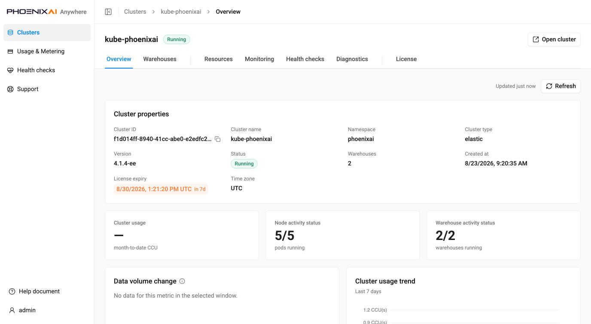

**Warehouses** — one card per warehouse including the built-in one, badged **Builtin warehouse**
or **Normal warehouse**, with requests and limits, replicas, autoscaling range, creation time,
pods running/total and utilization.

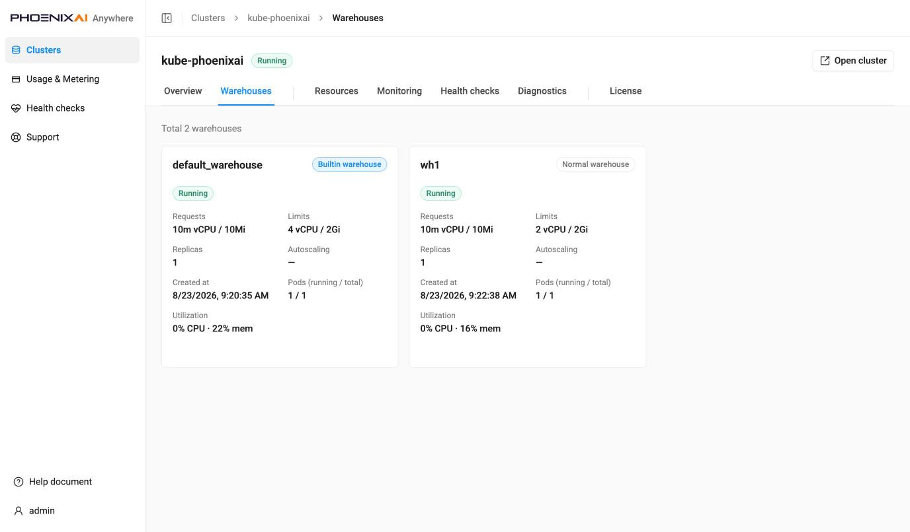

**Resources** (breadcrumb: Resources & Topology) — a health strip (nodes ready, warehouse count,
"All components healthy"), then the cluster object itself and expandable groups: Coordinator
(shared across all warehouses) and Warehouses, each warehouse running its own compute nodes, with
each group naming its image and its requests and limits. Each row's **View** shows its manifest
and recent Kubernetes events; pods carry live CPU and memory against requests.

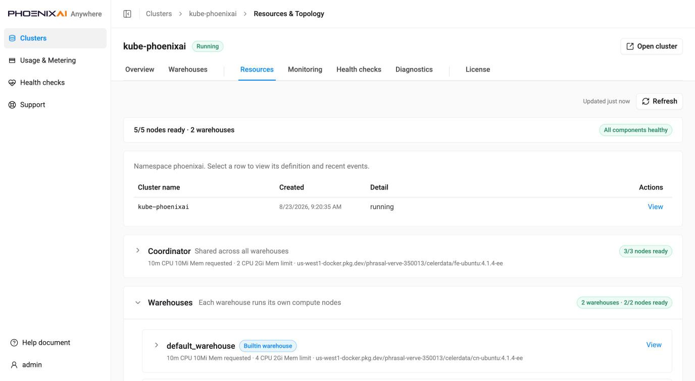

**Monitoring** — charts over a selectable time range and display timezone, split between
**Cluster state** and **Instance state**, with a one- or two-charts-per-row layout that can be
reordered, and a per-chart aggregation selector. The display timezone defaults to **UTC+00:00**.
Which charts appear, and which aggregation each defaults to, depends on what the cluster's
PhoenixAI version exposes — treat any specific set as an example rather than a fixed list; here it
is Cluster Data Size, Query QPS, Ingested Times and Ingested Rows. Each chart title carries a
tooltip describing what that chart measures. An empty chart means no data in the selected window;
if one is empty when you expect data, run the Prometheus dependency check described in
[Point the Anywhere Console at Prometheus](../Monitor/anywhere-monitoring.md).

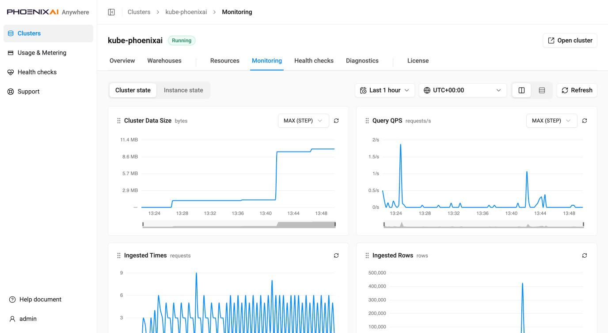

**Health checks** — this cluster's checks by type (info / warning / critical), status, component
and message, each naming the check that produced it, with sortable columns, filters and
pagination. A real cluster produces a substantial list — a couple of dozen findings on a newly
built cluster — and they are specific and actionable rather than generic: an expiring license,
CPU limits set on latency-sensitive components, multi-replica components not spread across
topology domains.

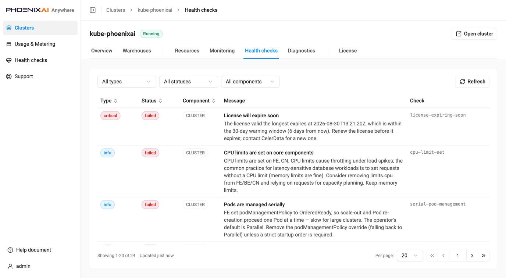

**Diagnostics** — two collapsed libraries, each reporting how many entries it holds (16 SQL
commands and 1 shell command here). **SQL commands** runs saved read-only commands for this
cluster; **Shell commands** runs a saved shell command inside one pod. Expanding a library reveals
its picker, **Run**, and **New command**; results report exit code, stdout and stderr. Creating
custom shell commands is gated by configuration and can be disabled entirely.

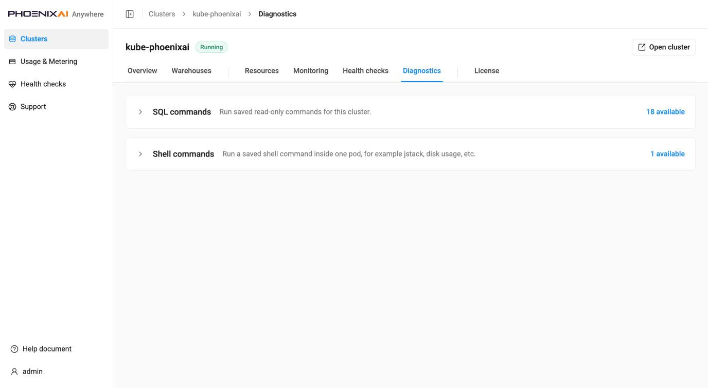

**License** — the effective license for this cluster: what it is bound to, expiry with days
remaining, capacity used against licensed cores, **Register license**, and the registered-licenses
table marking which one is effective. Times are UTC.

A newly created cluster already carries a license — nobody registers one by hand — but it is
short-lived, so a fresh environment shows **Expiring soon** and Health checks raises
`license-invalid` as critical (until 2026-08-24 this rule was `license-expiring-soon`, before it
merged with `license-missing`). That is expected on a new cluster, not a misconfiguration.

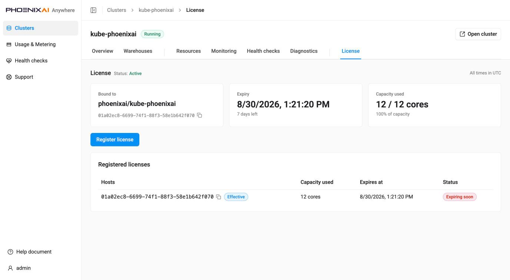

## Warehouse detail — `/clusters/{ns}/{name}/warehouses/{warehouse}`

A warehouse as its own page rather than a dialog, so it is deep-linkable, with its own Overview,
Resources and Health checks tabs. Overview carries requests and limits, replicas, autoscaling,
created, cluster, version, pods, utilization and image.

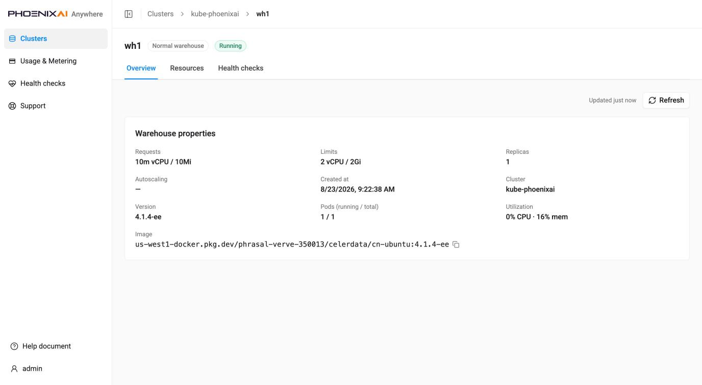

## Usage & Metering — `/usage`

Install-level metering across all clusters, in three tabs. **All times are UTC.** Clusters running a
PhoenixAI version that does not expose the usage metric are called out as *not metered*, with
the required version stated, rather than shown as zero.

**Overview** — this month's CCU, clusters tracked, collector status, last metered at, and the
metering periods table with the CCU formula in force (`CCU = 0.9 x coreSeconds/3600/4 (v1)`).

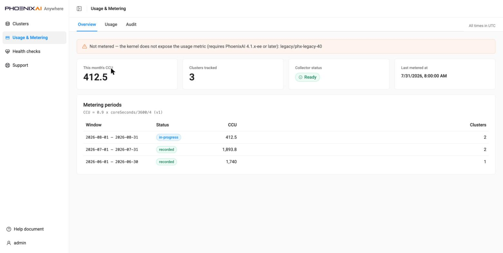

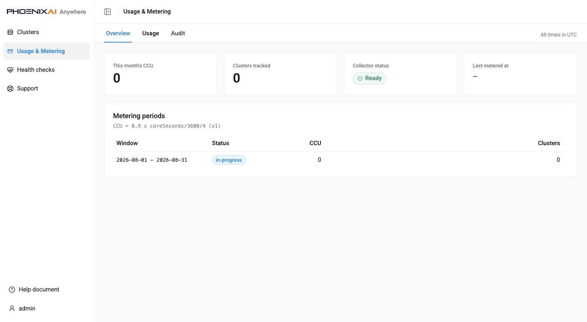

**Usage** — the cluster usage graph per day, filterable to one cluster or all, over 1M / 3M / 6M
/ YTD / 1Y / MAX, switchable between Graph and Details.

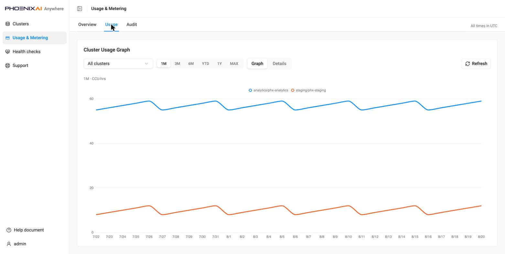

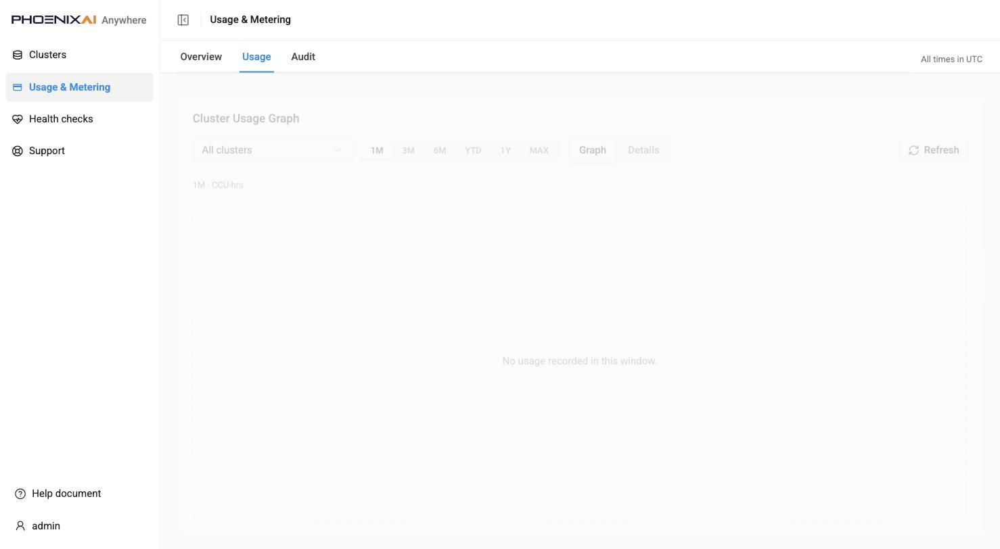

**Audit** — the complete record set behind those numbers: record count, sampling interval, how
CCU is derived, per-cluster first/last record and sequence range, counter resets explained, and
**Download JSON** of every raw record with sequence numbers and hashes for verification.

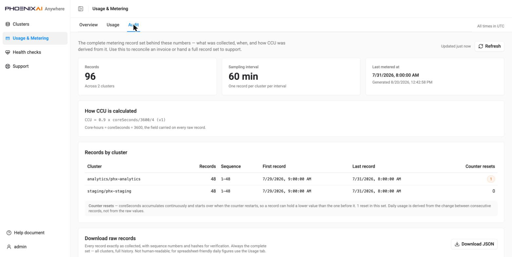

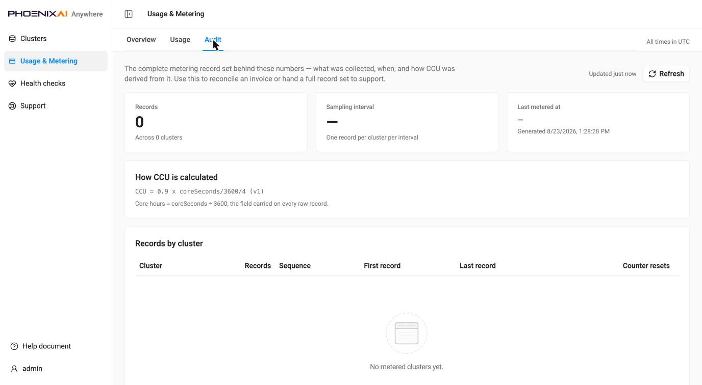

## License — `/license`

The install-level license page, with a cluster selector in the header (licenses are
cluster-scoped) and **Register license**. Shows what the license is bound to, expiry with days
remaining, and capacity used. Times are UTC.

:::caution License history does not load in this release
The **License history** panel — activation, renewal and alert events — is served by an endpoint
the backend has not built yet (`/api/v1/license/events`, still marked a proposal in the
frontend's endpoint map). Against a real installation the request falls through to the SPA and the
panel reports `Failed to load … is not valid JSON`. The three summary cards above it are real.

Per-cluster license facts, including the registered-licenses table, are on the cluster's own
License tab and do work.
:::

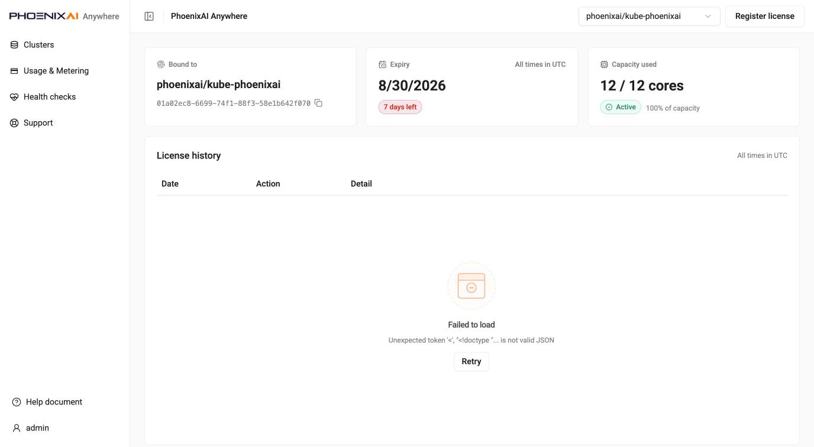

## Health checks — `/health-checks`

Every check across all clusters in one table — cluster, type, status, component, message and
check id — filterable by cluster, type, status and component, with sortable columns and
pagination. Findings are ordered by severity, then component, then rule id.

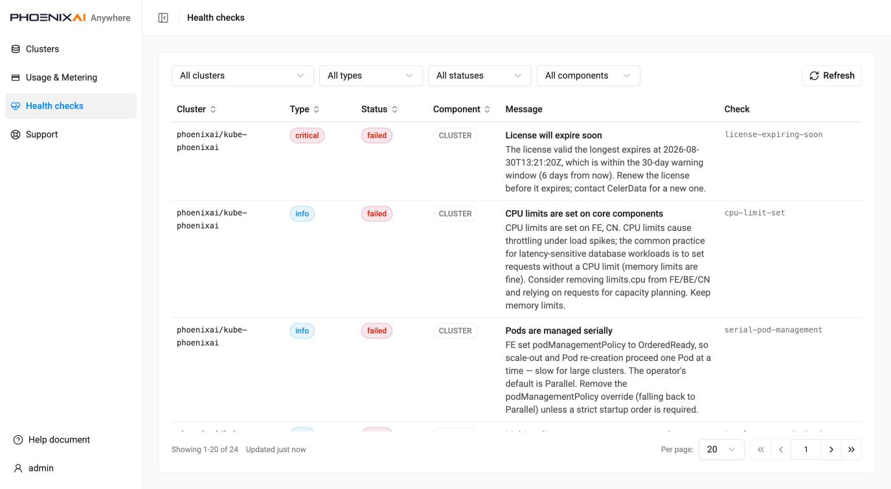

## Support — `/support`

Support bundles for the selected cluster: bundle name, cluster, created, size, status and the
categories collected. Finished bundles download from the name; the row actions view details, copy
an export link, and delete. An **Interrupted** bundle (Anywhere restarted mid-run) offers resume
instead. Sensitive values are excluded from bundles.

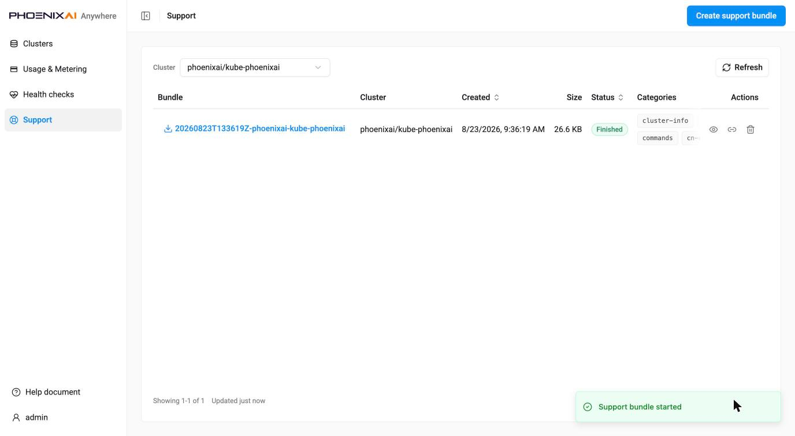

## Create support bundle — `/support/create`

A full-page composer, which collapses the sidebar to icons. The **Scenarios** rail on the left
("pick what you're seeing and we'll tick the artifacts support usually needs") preselects a set —
compute node crash, query trace, heavy or failing SQL, coordinator stall — or *Something else* to
choose freely; each names how many artifacts it selects. On the right, **What to collect** lists
every artifact with what it is for, its collector id (`cluster-info`, `config`, `logs`,
`commands`, `jstack`, `pstack`, `jvm-profile`, `audit-analysis`, `cn-crash-context`,
`metrics-snapshot`, `cn-memory`), a shared time window, and per-artifact parameters. Log
collection can take whole files or only lines matching a search — the choice that decides whether
hundreds of megabytes or tens are transferred. The page warns when a selection is incomplete and
an artifact would be silently skipped.

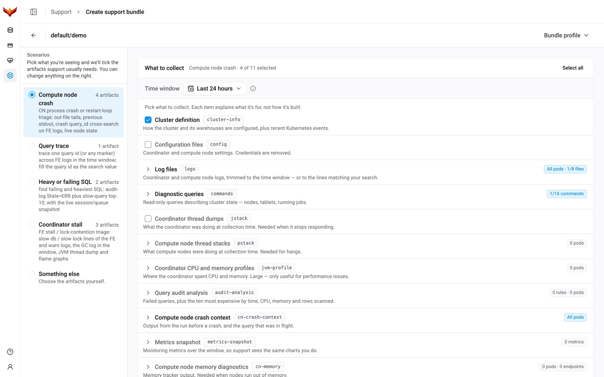

The footer carries an estimate — size and time to collect and download, with **Recalculate** — and
one primary action, **Create bundle**. A large bundle asks for confirmation first.

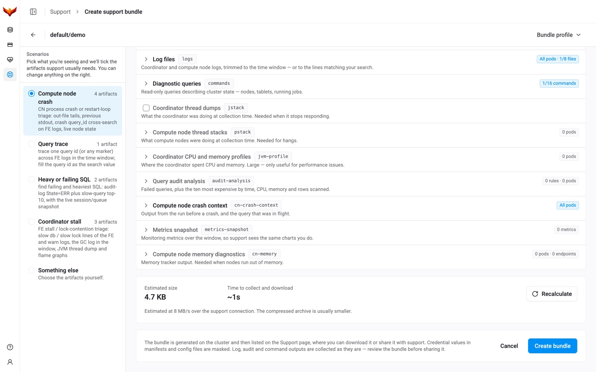

From v2.1, **Bundle profile**, at the right of the page header, on the row that names the cluster,
saves the current selection to a file and loads one back. *Save to file* writes the artifacts, pods,
time window and search values, with an optional note for whoever opens it, and no cluster name.
*Load from file* opens a review step that reports what the file asks for that this cluster does not
have before anything is applied; applying replaces the whole selection, and **Create bundle** is
still a separate press.
See [Generating a support bundle](../Troubleshoot/generate_support_bundle.md).

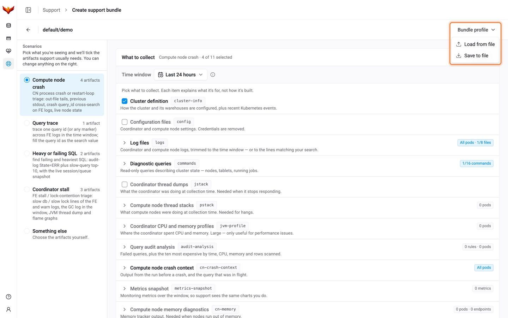

## Not found — `/404`

A full-bleed error page with a link home. Unknown URLs resolve here without a session, so a typo
or stale link never shows a sign-in page.

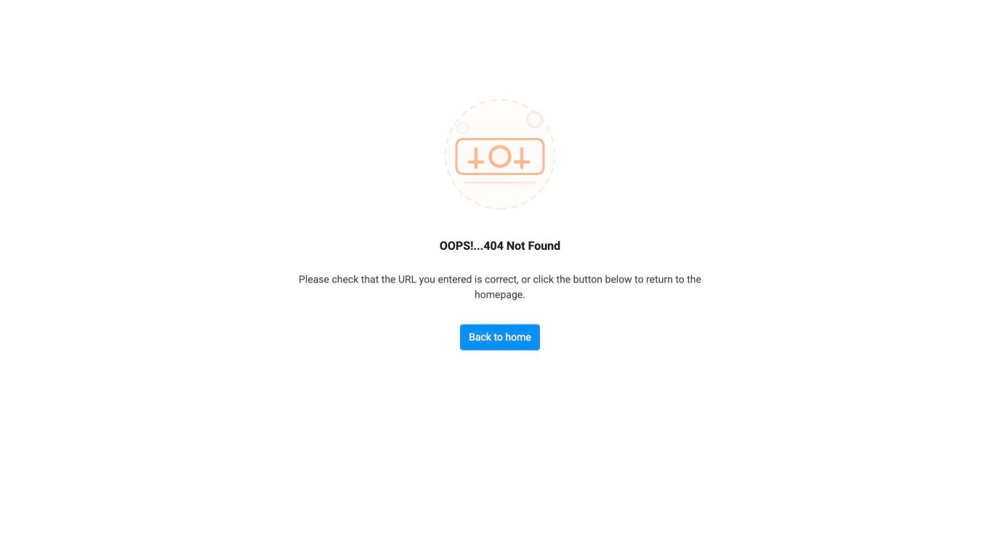
