# Cluster Console pages

## Sign in — `/cluster-console/login`

The **Database user** tab of the shared sign-in page. Select the cluster from the list, then
enter that cluster's database username and password. The two credential fields are labelled simply
**Username** and **Password** — the same as the administrator tab, because both tabs ask for the
same kinds of thing. The form notes that cluster credentials come from your platform admin.
Reaching the administrator sign-in is a tab away, and the brand hero panel is shared by both.

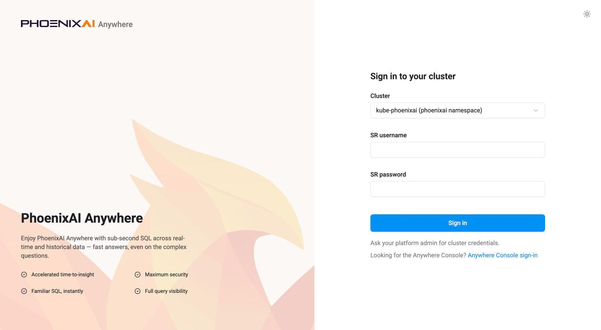

## SQL editor — `/cluster-console/sql` {#sql-editor}

Write and run SQL against the signed-in cluster, without a separate client. The left panel switches
between **your scripts** and the cluster's **schema**; the editor fills the rest, its script tabs
above it and its results below.

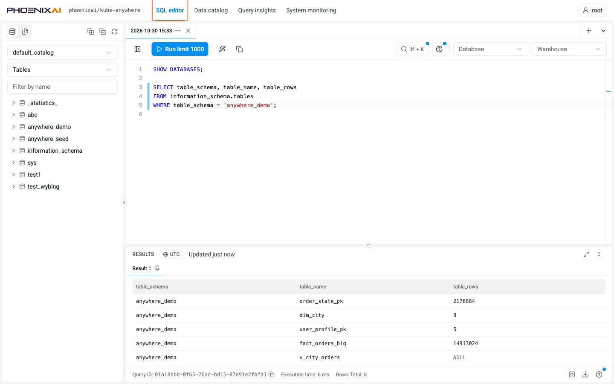

**Your scripts are saved by the console, not in your browser**, so they survive closing the tab,
signing out, and moving to another machine. They are private to your database user, and separate
per cluster. A script saves itself as you type, and ⌘/Ctrl + S saves it immediately. Closing a tab
only takes it off the tab strip — the script stays in the tree, and deleting it is a separate
action. Scripts can be grouped into folders, nested up to five deep, and moved by dragging them onto
a folder or with **Move to** in the row's menu. A new workspace opens with one
script, *Getting started*, which is an ordinary script and can be renamed, edited or deleted.

**Run** runs the statement the cursor is in, or the selection when there is one — a selection
holding several statements runs them in turn; ⌘/Ctrl + Enter does the same. Each script keeps its
own cursor and its own undo history, so switching to another tab and back runs the same statement
and undoes that script's own edits, and the lines that ran are marked in the gutter. When the
statement is a query the row limit could cut, the button says so before it runs: **Run limit 1000**.
Each statement gets its own numbered result tab, which shows whether it is queued, running, failed,
cancelled or skipped. A result exports as an Excel file — as CSV instead once a cell is too long for
Excel, which the button says before the press. A statement with no result set says so instead — a
row count for DML, **Succeeded** for `USE`, `SET` and DDL.

**The execution context belongs to the script** and is saved with it. The catalog is picked at the
top of the Schema panel, and the toolbar then shows it as text where it is not the internal
catalog; the database and the warehouse are picked on the toolbar itself.

**Set the database before running a statement that does not name one.** A new script starts with
none, and a table written unqualified resolves against whichever database the toolbar shows: the
wrong one resolves to the wrong table or to none, and with none selected the statement fails.
Either pick it on the toolbar or `USE` it in the script — a `USE` moves the toolbar with it once
the script has run, so the two stay in agreement. Each tab holds its own database session, which
is why a `USE` or a `SET` in one tab does not reach another. Closing the tab ends that session, and
so does leaving the editor page — opening Data catalog, say, or reloading the browser — or 30
minutes with nothing run in it. The next run opens a fresh session with the catalog, database and
warehouse the toolbar shows, and without any `SET` state.

A session is opened with the credentials you signed in with, and keeps them. A password changed in
the cluster after that does not stop a tab that already has a session; it stops the next session
the tab opens. Creating, editing or dropping an external catalog, or opening its edit form, opens
a connection of its own each time, so it is refused on the next try. The rest of the Cluster
Console — browsing the data catalog, Query insights — reuses its connections for up to a minute, so
it can keep working for that long before it reports the credentials as rejected.

**The Schema panel** lists the catalogs, databases, tables, views and materialized views the
signed-in user can see, filtered by name, and a table's menu writes a `SELECT` for it. Completion
follows the execution context: the objects in that database, and the columns of the tables the
statement already names.

**⌘/Ctrl + K opens the command palette**, which searches every action in the editor and every
script by name. *Tour of this page* and *Keyboard shortcuts* are both in it.

The editor has hard limits, none of them configurable:

- A statement returns at most **1,000 rows**, and one run returns at most **16 MiB** in total.
  Results cut short say so. `EXPLAIN` is exempt from the row limit.
- A script holds **500,000 bytes** and runs at most **50 statements** at a time.
- A cluster holds **50 scripts and 50 folders** for each user, closed scripts counted.
- A tab's session is dropped after **30 minutes** with nothing run in it, and one user holds at
  most **10** at a time. A dropped session loses the `SET` state in that tab; the toolbar's context
  and the script itself are unaffected.

How long a statement may run is set by the cluster's `query_timeout`, not by the console.

## Data catalog — `/cluster-console/catalog`

Browse the data this cluster can read, and set up the external data it reads. Start at the
catalogs and drill into databases, tables and their columns, partitions and DDL, searching at every
level. External catalogs are created, changed and dropped from here as well.

**Catalogs** — every catalog with its type and comment, and, on each external catalog, controls to
edit or drop it. A cluster with no external catalogs configured shows only `default_catalog`, typed
**Internal**, whose controls are disabled: the internal catalog cannot be edited or dropped.

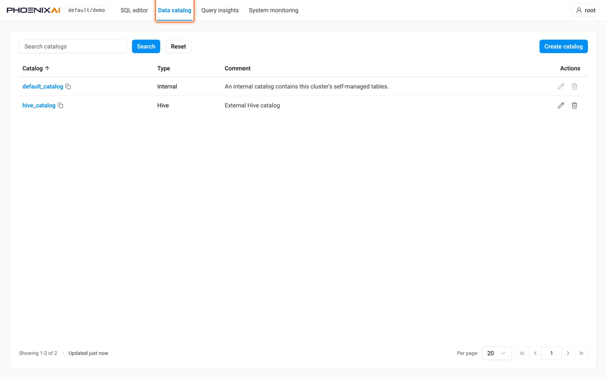

**Create catalog** opens a three-step form — type, connection, storage — organised by the type of
metastore and the type of storage rather than by cloud provider. The metastore types are Hive
Metastore, AWS Glue, Databricks Unity Catalog and Iceberg REST; Hive Metastore and Glue then ask
for a table format — Hive, Iceberg, Hudi or Delta Lake — while Unity is Delta Lake and Iceberg REST
is Iceberg. The storage types are Amazon S3, Azure Data Lake Storage Gen2, Azure Blob Storage and
Google Cloud Storage, with "vended by the catalog" for the services that issue their own storage
credentials. Each field is labelled in plain words with the underlying property key beneath it, so
what the form writes stays visible. An option the cluster's PhoenixAI Database version does not
support is disabled and says which version it needs.

A catalog authenticates to its metastore, and to its storage where it has storage of its own. The
form takes exactly one method for each and will not submit a second, so a catalog cannot be created
that falls back to unauthenticated access without saying so.

Submitting ends in one of five ways:

- **Created.** The form closes and the catalog is in the list, ready to query.
- **Created, but the metastore cannot be reached.** Most types are not contacted until something
  queries them, so a wrong address or credential survives creation. The page reports the reason
  the cluster gave, and offers the controls to edit or drop the catalog.
- **Created, but not visible to you.** Creating a catalog does not grant you anything on it. When
  it will not appear in the list, the page says so and tells you to ask an administrator for the
  privilege.
- **Not created.** The cluster refused it: the name is taken, your database user may not create
  catalogs, or — for a type that connects while it is being created, Iceberg REST among them — the
  endpoint or the credential did not work. The reason comes back on the form in the cluster's own
  words.
- **No answer in time.** The request times out after one minute, and reports that the cluster may
  still complete the statement. Check whether the catalog exists before submitting again.

A session that has expired ends the same way here as on every other page of the Cluster Console:
the next request asks you to sign in again. A password changed in the cluster underneath you is
noticed as soon as the console opens a new connection. Creating, editing or dropping a catalog,
or opening its edit form, opens one every time, so the next of those reports the credentials as
rejected and asks you to sign in again. Browsing catalogs, databases and tables reuses connections
for up to a minute, so it can keep working for that long first. An open
[SQL editor](#sql-editor) tab keeps the connection it already has.

**Editing** changes the values a catalog was created with, not its shape: the metastore type, the
table format, the storage and the two authentication methods are fixed once it exists. Changing one
of those means dropping the catalog and creating it again, which loses the privileges granted on
it. The console does not warn about that, so note the grants before you drop.

A catalog created with SQL rather than with this form can be edited here only when its properties
are exactly what one of the form's paths would have written. One carrying a property the form does
not offer, or two authentication methods, is shown read-only; change it with SQL instead.

Where a credential is a pair — an access key and its secret key — replacing either one asks for
both, so a new key cannot be saved beside an old secret and then fail at the first query that needs
storage.

**Dropping** asks you to type the catalog's name. Queries, views and materialized views that
reference the catalog stop working, the grants do not come back with a catalog of the same name,
and creating it again needs its credentials, which cannot be read back from the console.

**Databases** — the databases in a catalog, with table count and size.

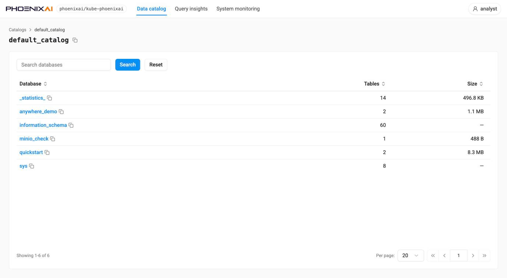

**Database detail** — tabs for **Tables**, **Materialized views**, **Views** and **Tasks**
(`?view=`). The Tables tab lists rows, size, creation time, and the table model under a column
headed **Remark** (`OLAP` for an ordinary table) rather than a free-text description.

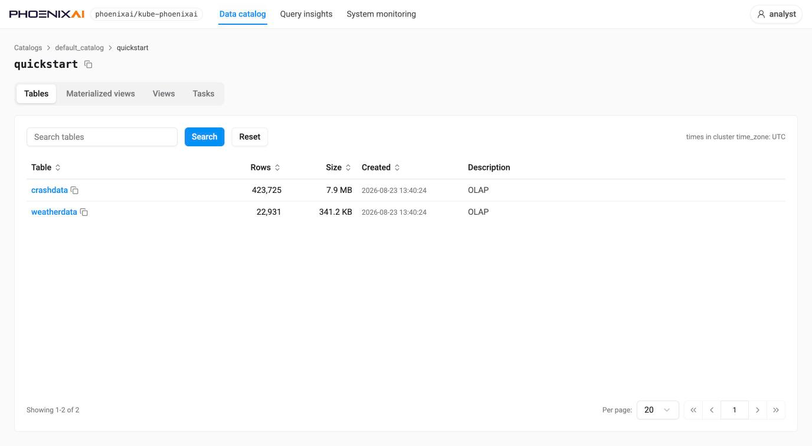

**Tasks** groups jobs by kind in a left-hand rail — Kafka Import, Other Import, Export, Schema
Change, Creating View (`?task=`) — and **the columns differ by kind**: an import job carries its
identifying **Tag**, state, table, created, paused, task count, progress and the reason a stage
changed, and is searchable by job name; a schema-change job carries table, status, progress, start
and end time, timeout and details, and is searchable by table. A kind with nothing to show reports
"No tasks reported."

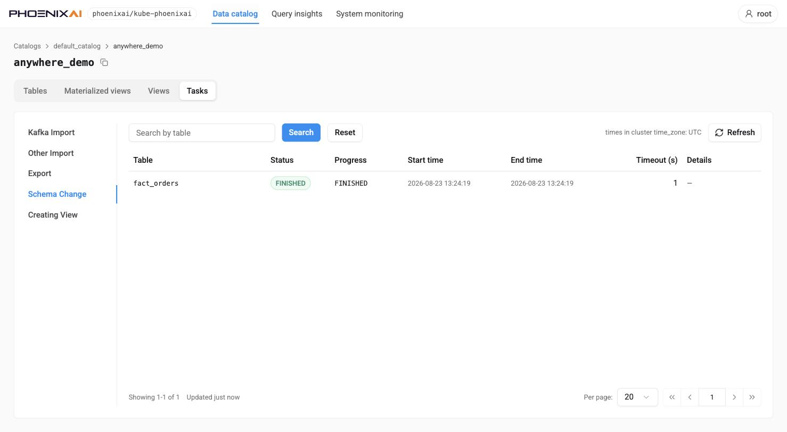

**Table detail** — tabs for **Columns** (type, nullability, key, default, extra, comment), **DDL**
and **Partitions** (`?tab=`).

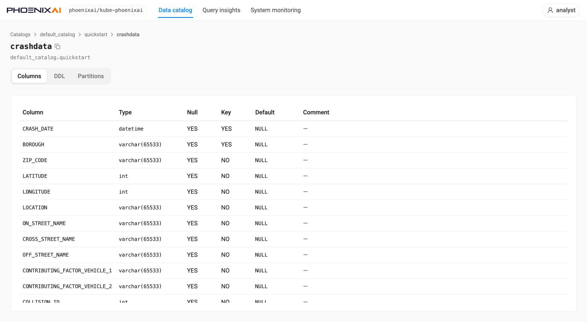

Partitions lists state, visible version, partition key, range, bucket column, buckets, duplications
and size, one row per partition. In shared-data mode the **Duplications** column reads `0` —
replication is the object store's job, not the cluster's — and an unpartitioned table shows a
single row named after the table.

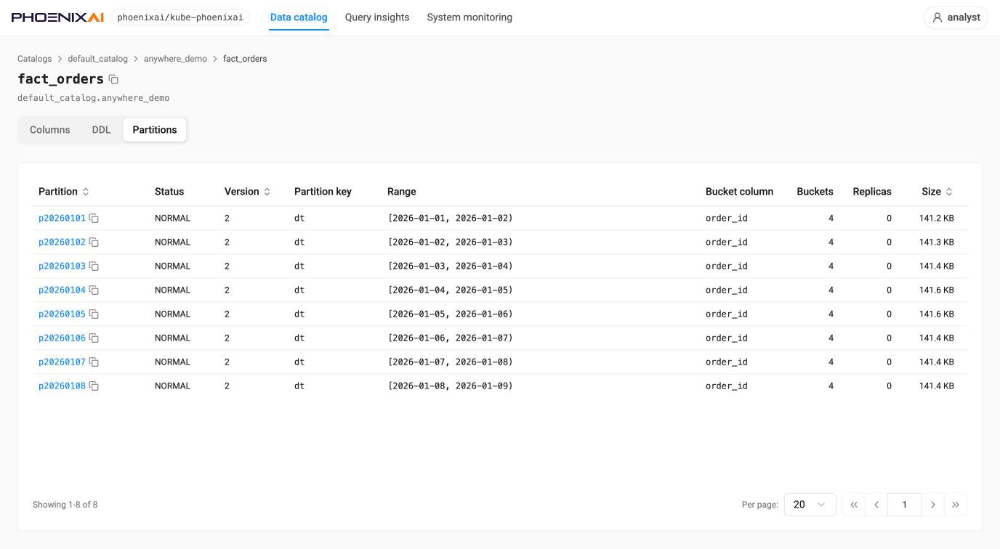

## Query insights — `/cluster-console/query-insights`

Query records with filters: status, time range (**Last 3 hours** by default) and display timezone,
user, warehouse, duration bounds, and a search by query ID, plus a **Columns** control.
Columns follow the familiar query-history vocabulary — start time, query ID, status, SQL,
warehouse, duration, memory, client IP, query user, source, queue time, CPU cost, scanned bytes
and rows. The list pages by scrolling and reports when it reaches the end.

Clicking a statement in the SQL column shows it in full. **Open in the SQL editor** at the foot of
that view takes it to the [SQL editor](#sql-editor) as a new script named after the query ID, in a
new browser tab, so a slow query can be changed and re-run while the filtered list stays where it
was.

Records are scoped by the signed-in user's own SQL privileges, so `root` sees the cluster's
internal statistics queries and other users' work, while an ordinary user sees only what it is
entitled to.

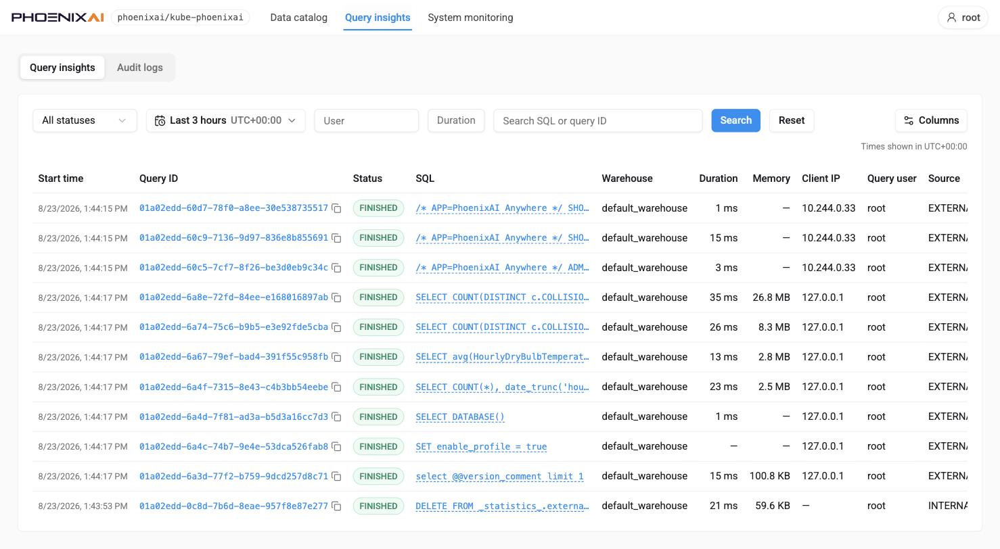

:::note Audit logs is visible only to the database `root` user
**Audit logs** is a sibling sub-tab of Query insights (`?view=audit`), but it is rendered **only
when the database user signed in to this cluster is `root`**. Any other user — however privileged
in SQL — sees Query insights with no sub-tabs at all and no indication that the tab exists.

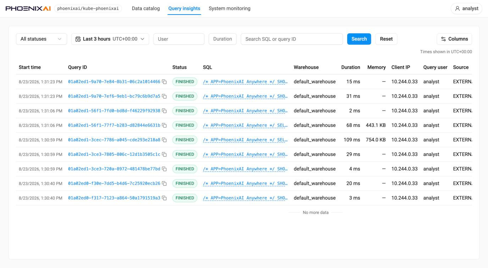
:::

The page has two distinct empty states, and each names its own remedy:

- **Query collection is off on this cluster.** This is the default, so it is what a new
  installation sees. Two settings in two different places must be enabled — `queryHistory.enabled`
  in the Helm values, *and* the FE configuration `enable_collect_query_detail_info` on every FE.
  The banner names both.
- **Collection is on, but not every query is kept.** The page then states the policy in force —
  for example "showing slow queries ≥ 5000 ms and failed queries only" — instead of appearing
  empty for no reason. A separate banner flags when query *profiles* are switched off on the
  cluster, and what to set to enable them; that banner can be dismissed for the visit.

The steps behind both banners — the two switches, choosing which queries to keep, and making sure
the kept ones carry a profile — are in
[Collect query history for Query insights](../Monitor/anywhere-query-insights.md).

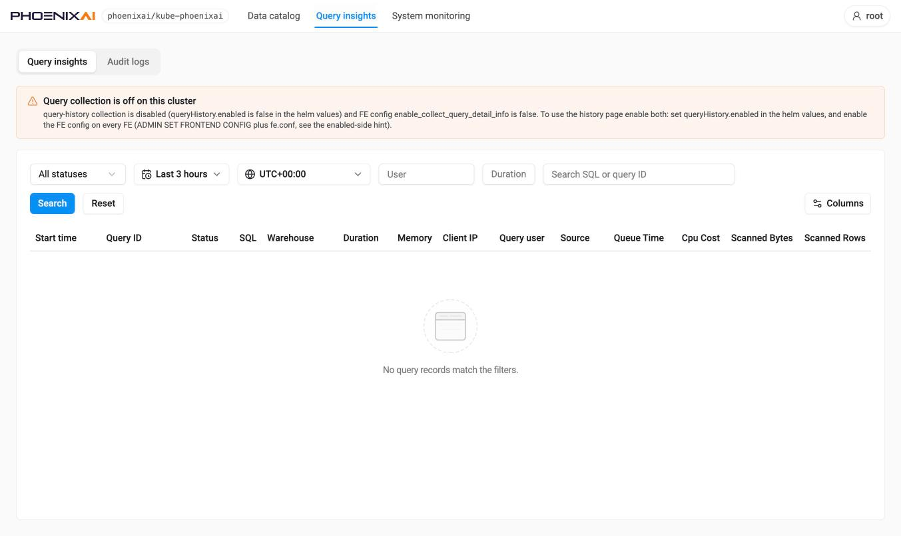

The time-range control offers quick ranges from the last 5 minutes to the last 14 days, plus a
custom range with a calendar and from/to times. Changes take effect when **Search** is pressed,
and an absolute range keeps the instants it was given when the display timezone changes.

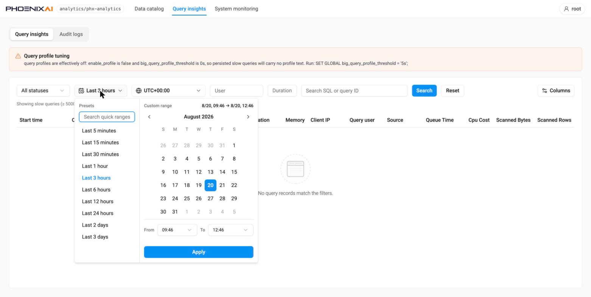

**Audit logs** — pick an FE node and a time window, optionally a keyword or query ID, then search.
Results show start time, query ID, state, cost, user, client address and statement. Statements are
recorded as the FE saw them, with credentials masked.

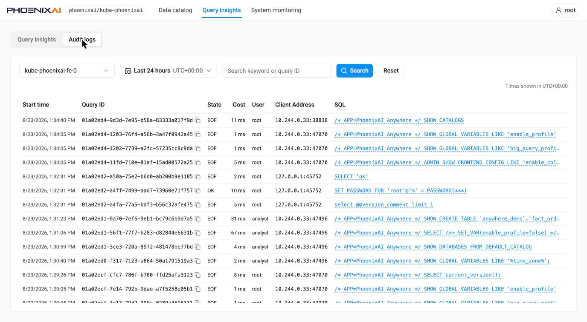

## Query detail — `/cluster-console/query-insights/{queryId}`

One query record, as **Query overview** and **Query profile**. Overview carries the summary
(user, database, catalog, warehouse, FE, client IP, timings, queue time, CPU cost, memory,
scanned rows and bytes, digest, source), then the statement's **SQL** and its **Explain** plan, each
in a panel of its own with its tools on the panel's bar. SQL can be formatted and copied; Explain is
open by default, folds away from its bar, and can be copied or downloaded. **Expand** on either bar
opens it in a full-screen reader, which keeps the same tools — the easier way to read a long
statement or plan.

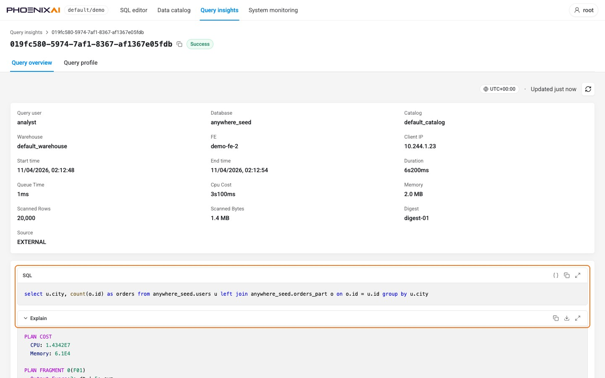

**Query profile** has two views, **Graph** and **Text**. Graph draws the plan as a diagram of
operator nodes carrying their own timings and row counts, with the slowest operators ranked beside
it as a percentage of total operator time, and the heaviest fragments ranked by memory. Selecting a
node opens its counters on the right — CPU and scan time, rows in and out, the table and rollup it
read, its predicates, bytes read, and its indexes. The profile can be copied, downloaded, or loaded
from a file captured elsewhere.

This is the fastest way to find where a slow query is actually spending its time. The ranking tells
you which operator to look at, and the node panel tells you why: a scan whose ScanTime dwarfs its
CPUTime is waiting on IO, and one reading far more rows than it returns is a predicate that is not
filtering.

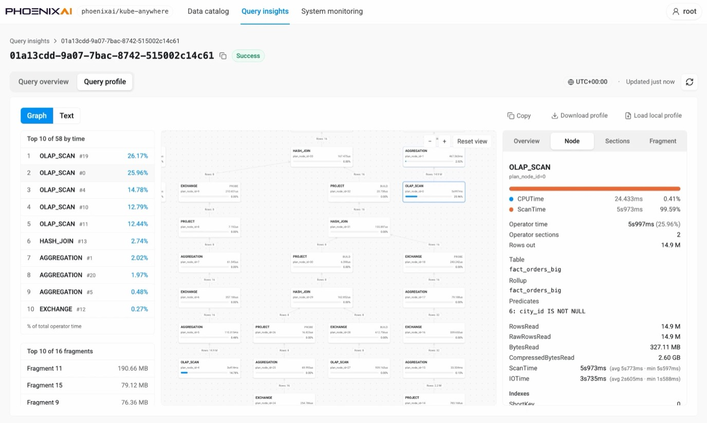

Text is the cluster's own profile text — summary, planner timings and the operator tree — in a
scrollable reader. It is also the fallback: a profile that does not carry the shape of the plan
renders as text rather than as a diagram.

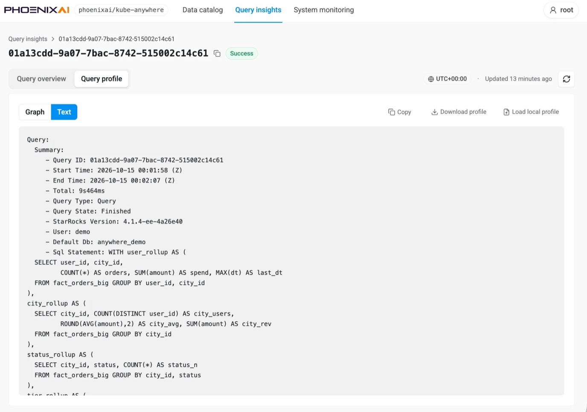

Either view is present only for queries the cluster profiled. Where it is absent the tab says so on
the record itself, naming the query's latency and the `big_query_profile_threshold` that excluded
it. A tutorial-sized query finishing in milliseconds is well under the default 30s threshold, so
"not profiled" is the ordinary answer there rather than a sign that anything is wrong.

## System monitoring — `/cluster-console/monitoring`

Readings for the cluster, over a selectable range and display timezone (UTC+00:00 by default),
with a note stating the window the "current" figures cover.

**Cluster state** — active and queued query counts, plus cluster-wide charts (Cluster Data Size,
Query QPS, Ingested Times, Ingested Rows). A metric the cluster does not expose says so in place
of the number — query queue metrics, for instance, report as unavailable rather than as zero.

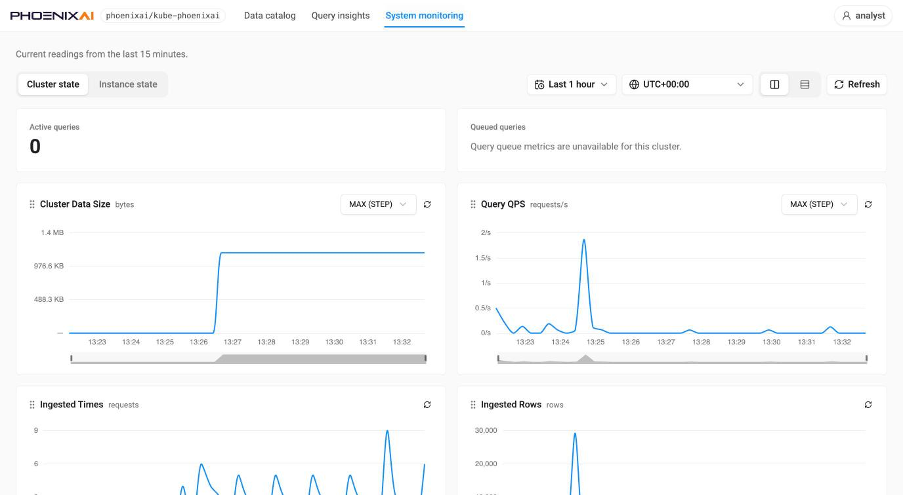

**Instance state** — a node tree (coordinator nodes, and compute nodes grouped by warehouse) that
scopes the charts to the selected instances, each node listed with its address and pod name.
Charts here cover FE JVM heap used and utilization and, when the Prometheus behind Anywhere also
scrapes kubelet/cAdvisor, pod CPU and memory utilization. **Charts** and **Latest values** are
switchable views of the same series.

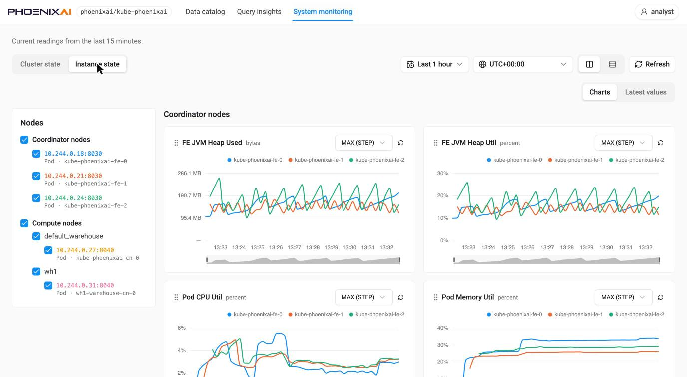
